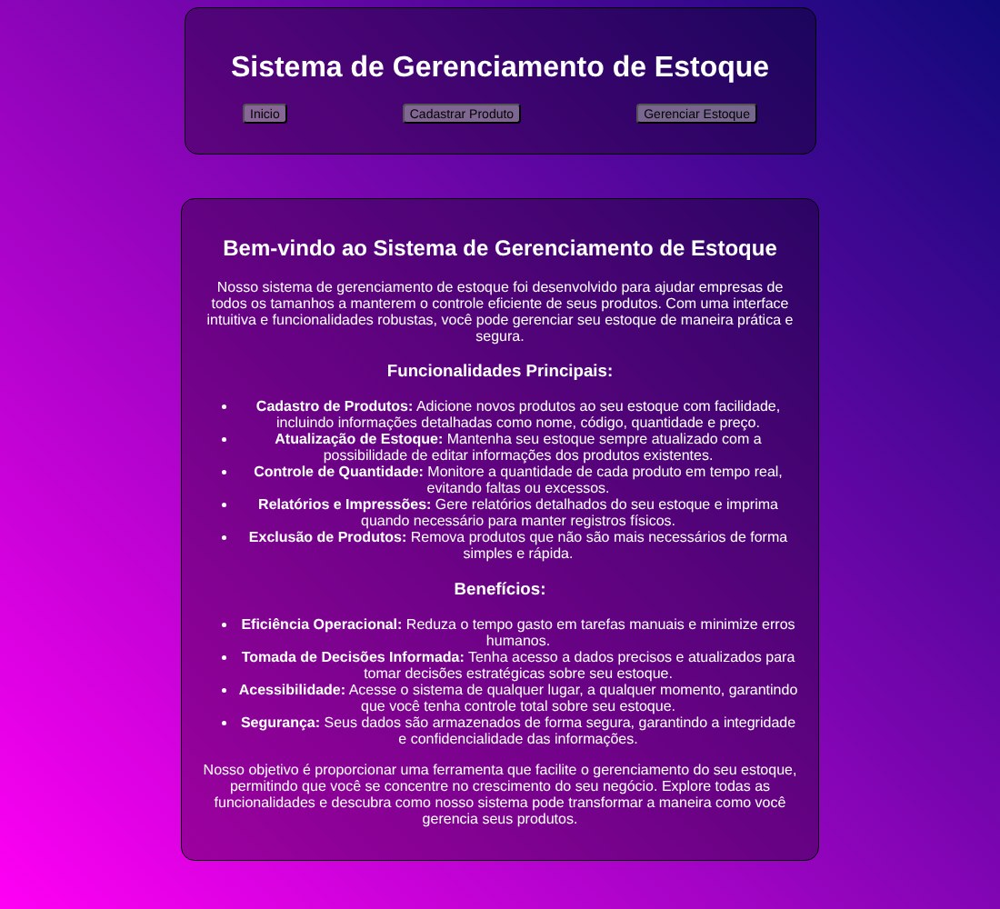
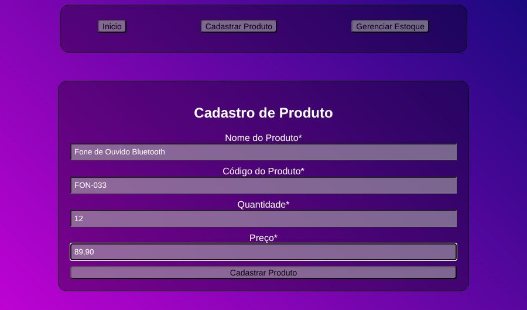
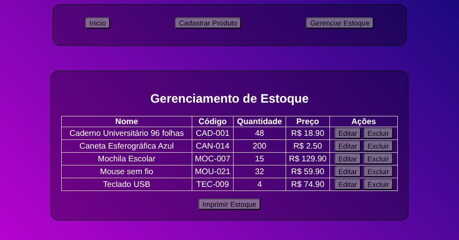

# 📦 Sistema de Gerenciamento de Estoque

Aplicação web para cadastrar, consultar, editar e excluir produtos de um estoque. Feita só com HTML, CSS e JavaScript no navegador, e os dados ficam no **Firebase Realtime Database**, acessado pela API REST dele (sem biblioteca extra).



## ✨ Funcionalidades

* **Cadastro de produtos** com nome, código, quantidade e preço. O formulário valida os campos obrigatórios e exige um preço positivo (aceita vírgula, como em `89,90`).
* **Lista do estoque** em tabela, carregada do banco.
* **Edição na própria linha:** os campos da tabela viram inputs, e o botão Salvar atualiza só aquele produto.
* **Exclusão** com confirmação.
* **Impressão do estoque:** o botão abre a impressão do navegador, e regras de impressão (`@media print`) escondem o menu e os botões para sair só a tabela.

## 🖼️ Telas

| Cadastro de produto | Gerenciamento do estoque |
| --- | --- |
|  |  |

> As imagens mostram produtos de exemplo.

## 🛠️ Tecnologias

* HTML5 e CSS3
* JavaScript (`fetch`, manipulação do DOM e `async/await`)
* Firebase Realtime Database, usado pela API REST (`GET`, `POST`, `PATCH` e `DELETE` no caminho `/produtos`)

## 📂 Estrutura

```text
Gerenciamento de Estoque/
├── index.html           # apresentação do sistema
├── cadastro.html        # formulário de cadastro
├── gerenciamento.html   # tabela com edição, exclusão e impressão
├── css/
│   ├── styles.css       # estilos da tela e regras de impressão
│   └── print.css        # estilos de impressão alternativos (ainda não usados nas páginas)
└── js/
    ├── firebase.js      # funções de acesso ao banco (salvar, listar, atualizar, excluir)
    ├── validacao.js     # validação e envio do formulário de cadastro
    └── gerenciamento.js # tabela de produtos e edição
```

## ▶️ Como rodar

Não precisa instalar nada. Abra a pasta `Gerenciamento de Estoque/` e dê dois cliques em `index.html`, ou sirva a pasta com qualquer servidor estático. É preciso ter internet para o sistema se comunicar com o banco.

### Usando o seu próprio banco

O endereço do banco fica em `js/firebase.js`. Para usar o seu:

1. Crie um projeto no [Firebase](https://firebase.google.com) e ative o **Realtime Database**.
2. Troque o valor de `databaseURL` em `js/firebase.js` pelo endereço do seu banco.
3. Ajuste as regras de acesso do banco (aba **Regras**). Este projeto não tem login: em modo de teste, qualquer pessoa com o endereço consegue ler e alterar os dados. Antes de usar com dados reais, adicione autenticação e regras mais restritivas.

## 🔭 Possíveis melhorias

* Autenticação de usuários e regras de acesso no Firebase
* Alertas de estoque baixo
* Busca e ordenação na tabela
* Tornar o layout mais responsivo (hoje a tabela fica mais larga que o painel quando uma linha está em edição)
* Usar o `print.css`, que tem uma versão de impressão mais completa, no lugar da regra simples do `styles.css`

## 👩‍💻 Autora

**Inglid Sandeski**: estudante de Sistemas de Informação na UNEMAT.
[GitHub](https://github.com/inglid-sandeski)
